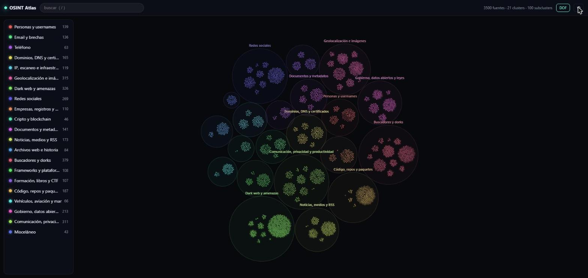
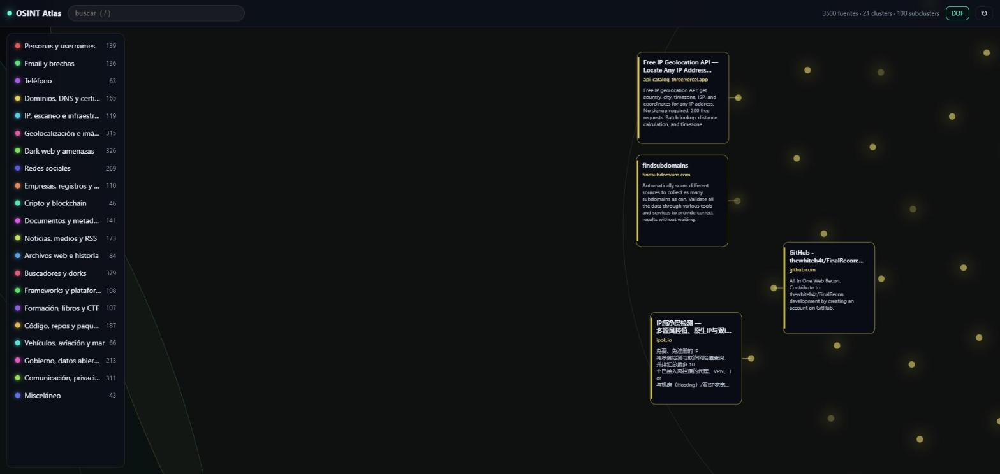
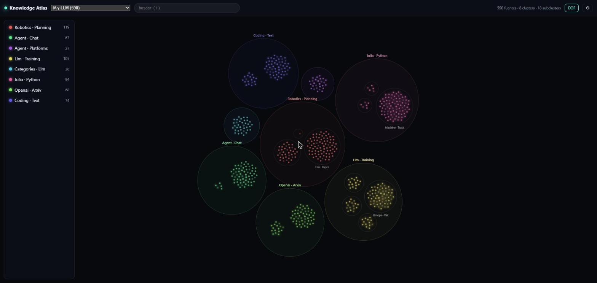

<p align="center"><a href="README.md">Español</a> · <b>English</b></p>

# Knowledge Atlas

Six fractal graphs with 5,958 sources, on a single website. It opens with **OSINT** and a selector switches graphs: clusters → subclusters → points, with previews as you zoom in.

**Demo:** https://virtuanista.github.io/knowledge-atlas/

## Preview

| OSINT | Zoom: previews | AI and LLM |
|---|---|---|
|  |  |  |

## Topics
| Graph | Sources |
|---|---|
| OSINT (default) | ~430 OSINT lists; see [osint/](osint/README.md) (in Spanish) |
| AI and LLM | awesome lists on LLM, ML, agents and RAG |
| Algorithms and data structures | awesome lists on algorithms, CS and interview prep |
| Web standards | awesome lists on web standards and the web platform |
| Open datasets | awesome lists on datasets and open data |
| Games and game dev | awesome lists on game dev, engines and games |

Figures by topic: OSINT 3,500 · AI 590 · Algorithms 490 · Standards 380 · Datasets 500 · Games 498 sources.

## How it is built
1. `scripts/discover.sh`: finds awesome lists by topic with `gh search repos`.
2. `scripts/extract.py`: downloads the READMEs, extracts links, dedupes and ranks by the number of lists that cite them. Excludes off-topic lists by name (security, CSS, etc.).
5. `scripts/make_credits.py`: generates CREDITS.md with only the lists that contributed sources.
3. `scripts/select_crawl.py`: takes the top per topic and reads the `<title>` and meta description of each URL.
4. `scripts/build_topics.py`: TF-IDF + deterministic k-means. Groups of more than 110 nodes are reclustered with their own TF-IDF (fractal division, up to 3 levels). Writes `docs/data/<topic>.json`.

## Limitations
- The sources come from community lists: they may contain outdated or off-topic links. They are filtered by keyword (offensive security, CSS/UI), but the filter is not perfect.
- Cluster names come from the most frequent words in each group (TF-IDF). They are indicative, not curated labels: some are noisy (e.g. «Julia · Python» in AI).
- There are only sources from GitHub awesome lists. There is no web search and no direct CSV/JSON datasets.
- Dead links are marked, not removed.
- The metadata (title, description) is read once, at build time.

## Usage
- Selector at the top left to switch graphs (`?g=osint`, `?g=ia`, `?g=algoritmos`, …).
- Wheel / pinch: zoom anchored to the cursor. Double click: zoom in. `+` / `-` / `0`.
- Click on a point: pins its card, and the "abrir fuente" (open the source) button is a native link.
- Esc: clears the selection. `/`: search.

## Rebuilding
```bash
python scripts/discover.sh && python scripts/extract.py
python scripts/select_crawl.py
python scripts/build_topics.py && python scripts/make_credits.py
```

## Credits
See [CREDITS.md](CREDITS.md) and [osint/CREDITS.md](osint/CREDITS.md) (both in Spanish). Code under MIT; third-party content under its authors' licenses.

<p align="center">
	Repository made by <a href="https://github.com/virtuanista" target="_blank">virtu 🎣</a>
</p>

<p align="center">
	
</p>

<p align="center">
	Copyright &copy; 2026
</p>
