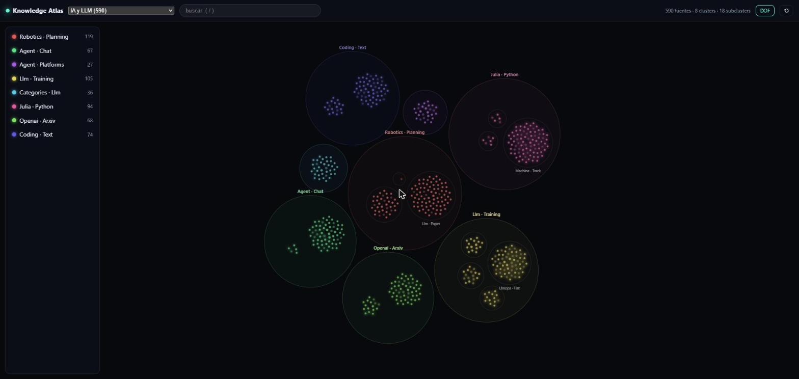

# Knowledge Atlas

Grafos fractales de fuentes técnicas, uno por tema. Mismo motor visual que [OSINT Atlas](https://github.com/virtuanista/osint-atlas): clusters → subclusters → puntos, con previews al acercar.

**Demo:** https://virtuanista.github.io/knowledge-atlas/

## Vista



## Temas
| Grafo | Fuentes |
|---|---|
| IA y LLM | listas awesome de LLM, ML, agentes y RAG |
| Algoritmos y estructuras de datos | listas awesome de algoritmos, CS e interview prep |
| Estándares web | listas awesome de web standards y plataforma web |
| Datasets abiertos | listas awesome de datasets y datos abiertos |
| Juegos y game dev | listas awesome de game dev, motores y juegos |

Cifras por tema: IA 590 · Algoritmos 490 · Estándares 380 · Datasets 500 · Juegos 498 fuentes.

## Cómo se construye
1. `scripts/discover.sh`: busca listas awesome por tema con `gh search repos`.
2. `scripts/extract.py`: baja los READMEs, extrae enlaces, dedupe y ranking por nº de listas que los citan. Excluye listas fuera de tema por nombre (seguridad, CSS, etc.).
5. `scripts/make_credits.py`: genera CREDITS.md solo con las listas que aportaron fuentes.
3. `scripts/select_crawl.py`: toma el top por tema y lee `<title>` y meta description de cada URL.
4. `scripts/build_topics.py`: TF-IDF + k-means determinista. Los grupos de más de 110 nodos se reclusterizan con su propio TF-IDF (división fractal, hasta 3 niveles). Escribe `docs/data/<tema>.json`.

## Limitaciones
- Las fuentes vienen de listas comunitarias: pueden tener enlaces obsoletos o fuera de tema. Se filtra por palabras clave (seguridad ofensiva, CSS/UI), pero el filtro no es perfecto.
- Los nombres de clusters salen de las palabras más frecuentes de cada grupo (TF-IDF). Son orientativos, no etiquetas curadas: algunos son ruidosos (p. ej. «Julia · Python» en IA).
- Solo hay fuentes de listas awesome de GitHub. No hay búsqueda web ni datasets CSV/JSON directos.
- Los enlaces muertos se marcan, no se eliminan.
- Los metadatos (título, descripción) se leen una vez, en el momento de la construcción.

## Uso
- Selector arriba a la izquierda para cambiar de grafo (`?g=ia`, `?g=algoritmos`, …).
- Rueda / pinch: zoom anclado al cursor. Doble clic: acercar. `+` / `-` / `0`.
- Clic en un punto: fija su tarjeta y el botón "abrir fuente" es un enlace nativo.
- Esc: suelta la selección. `/`: buscar.

## Regenerar
```bash
python scripts/discover.sh && python scripts/extract.py
python scripts/select_crawl.py
python scripts/build_topics.py && python scripts/make_credits.py
```

## Créditos
Ver [CREDITS.md](CREDITS.md). Código bajo MIT; contenido de terceros bajo las licencias de sus autores.

<p align="center">
	Repositorio generado por <a href="https://github.com/virtuanista" target="_blank">virtu 🎣</a>
</p>

<p align="center">
	
</p>

<p align="center">
	Copyright &copy; 2026
</p>
