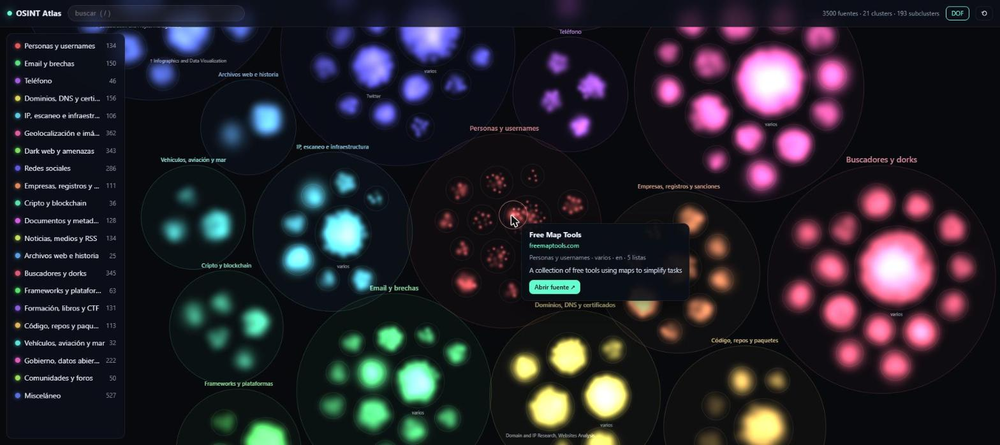
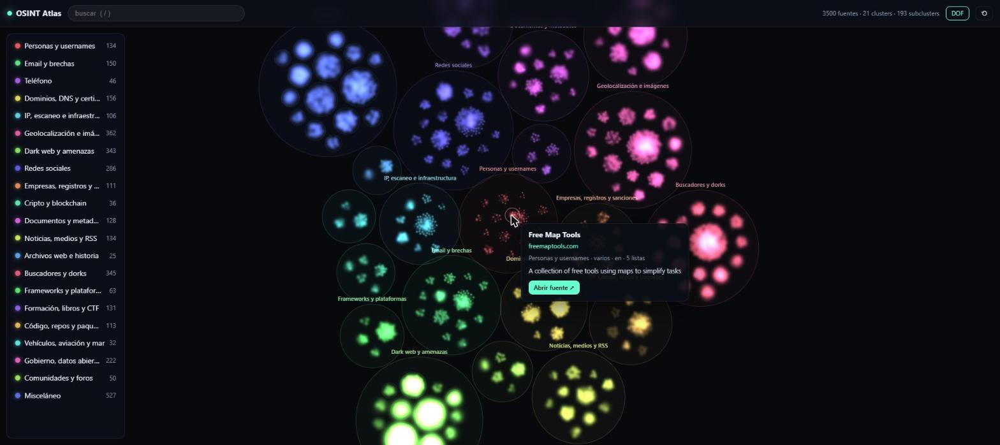

# OSINT Atlas

Grafo fractal atómico de **3.500 fuentes OSINT** deduplicadas, clasificadas en 21 clusters y 193 subclusters.

**Demo:** https://virtuanista.github.io/osint-atlas/

## Cómo funciona
- **Cosecha:** README de ~430 repos OSINT/awesome descubiertos con `gh search` (`scripts/discover.sh`, `scripts/fetch_readmes.py`).
- **Parseo y dedupe:** `scripts/parse.py` (enlaces Markdown/HTML/bare, normalización de host/path, sin `utm_*`), `scripts/curate.py` (filtro de ruido, ranking por nº de listas que la citan), `scripts/select.py` (top 3.500).
- **Clusters:** `scripts/classify.py` (reglas por heading → título → descripción).
- **Metadatos:** `scripts/crawl.py` hornea `<title>`, meta description y `og:*` de cada URL (2.527 vivas; 973 marcadas como sin respuesta).
- **Datos:** `scripts/build_data.py` → `docs/data/atlas.json`.
- **Render:** `docs/app.js`. Layout determinista (espiral de Vogel + relajación de círculos) en tres niveles: cluster → subcluster → átomo. Cada átomo es un splat gaussiano aditivo; al enfocarlo aparece la tarjeta de preview con blur animado. Canvas 2D, sin dependencias externas.

## Capturas

| Vista general | Cercano + profundidad de campo | Lejano |
|---|---|---|
|  |  |  |

## Profundidad de campo
- El átomo señalado (hover o clic) queda nítido con anillo de foco.
- Cada átomo se desenfoca según su distancia en pantalla al foco: 6 niveles de σ gaussiano precalculados por cluster.
- El tamaño del splat crece con la popularidad (nº de listas que citan la fuente).
- Botón **DOF** o tecla `D` para activar/desactivar.

## Uso
- Rueda / pinch: zoom anclado al cursor (animado). Arrastrar: mover. Doble clic: acercar. `+` / `-`: zoom. `0`: vista general.
- Clic en átomo: fijar tarjeta. Esc: soltar.
- `/`: buscar. Botones de la izquierda: ocultar/mostrar clusters.

## Reproducir
```bash
python scripts/discover.sh   # requiere gh autenticado
python scripts/fetch_readmes.py
python scripts/parse.py && python scripts/curate.py && python scripts/select.py
python scripts/crawl.py && python scripts/classify.py
python scripts/build_data.py && python scripts/make_og.py
```

## Créditos
Ver [CREDITS.md](CREDITS.md). Código bajo MIT; contenido de terceros bajo las licencias de sus autores.
