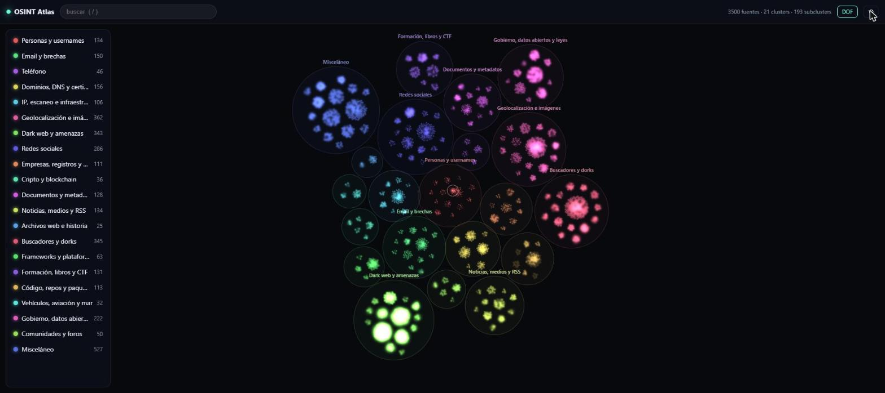
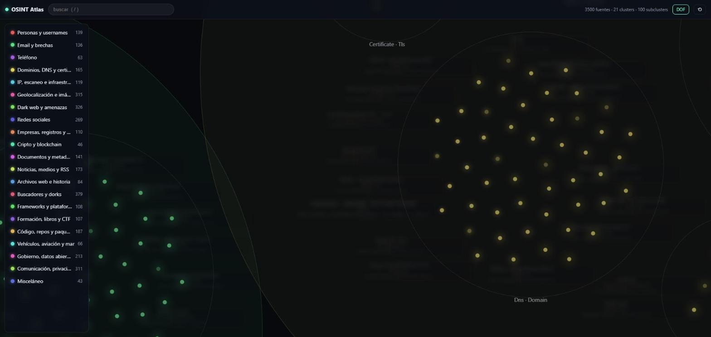
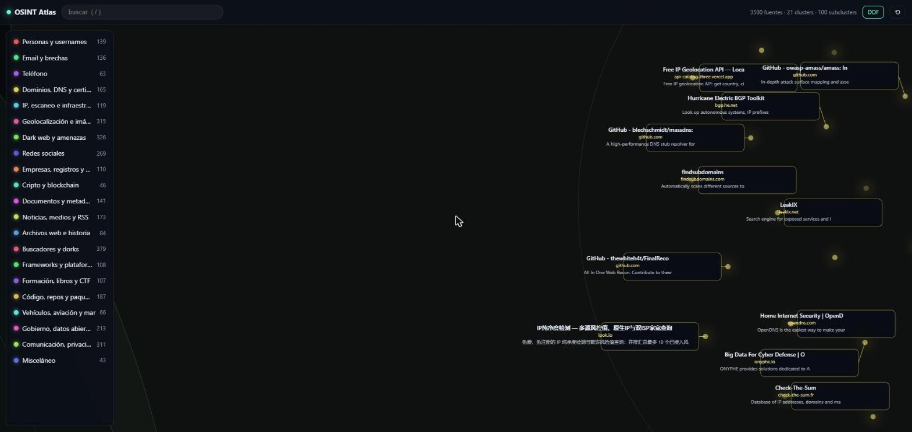

# OSINT Atlas

Grafo fractal atómico de **3.500 fuentes OSINT** deduplicadas, clasificadas en 21 clusters y 193 subclusters.

**Demo:** https://virtuanista.github.io/osint-atlas/

## Cómo funciona
- **Cosecha:** README de ~430 repos OSINT/awesome descubiertos con `gh search` (`scripts/discover.sh`, `scripts/fetch_readmes.py`).
- **Parseo y dedupe:** `scripts/parse.py` (enlaces Markdown/HTML/bare, normalización de host/path, sin `utm_*`), `scripts/curate.py` (filtro de ruido, ranking por nº de listas que la citan), `scripts/select.py` (top 3.500).
- **Clusters:** `scripts/classify.py` (reglas por heading → título → descripción) y luego `scripts/refine_clusters.py` (TF-IDF + centroides + k-means por cluster). `scripts/build_data2.py` genera el JSON final.
- **Metadatos:** `scripts/crawl.py` hornea `<title>`, meta description y `og:*` de cada URL (2.527 vivas; 973 marcadas como sin respuesta).
- **Datos:** `scripts/build_data.py` → `docs/data/atlas.json`.
- **Render:** `docs/app.js`. Layout determinista (espiral de Vogel + relajación de círculos) en tres niveles: cluster → subcluster → átomo. Cada átomo es un splat gaussiano aditivo; al enfocarlo aparece la tarjeta de preview con blur animado. Canvas 2D, sin dependencias externas.

## Capturas

| Vista general | Zoom: puntos individuales | Zoom: previews |
|---|---|---|
|  |  |  |

## Diseño visual
- **Puntos mate:** cada fuente es un disco sólido del color de su cluster, sin brillo. El radio en pantalla está acotado (1,5–5,5 px) para que al acercar se separen en lugar de agrandarse.
- **Sin solapes al acercar:** las fuentes se disponen con espiral de Vogel con separación fija, así que a zoom alto cada punto queda aislado.
- **Gaussianas:** halo suave bajo cada punto. Su σ crece con la distancia en pantalla al objeto señalado (profundidad de campo). Tecla `D` o botón DOF para activarlo.
- **Preview:** a partir de cierto zoom, cada punto visible muestra su tarjeta (título, dominio, descripción). La tarjeta aparece con blur que se resuelve al acercar y nunca cubre a otro punto.
- **Clusters:** 21 clusters y 100 subclusters, refinados con TF-IDF y k-means sobre título, descripción, headings y dominio.

## Uso
- Rueda / pinch: zoom anclado al cursor (animado). Arrastrar: mover. Doble clic: acercar. `+` / `-`: zoom. `0`: vista general.
- Clic en un punto: fija su tarjeta. Esc: suelta.
- Clic en átomo: fijar tarjeta. Esc: soltar.
- `/`: buscar. Botones de la izquierda: ocultar/mostrar clusters.

## Reproducir
```bash
python scripts/discover.sh                       # requiere gh autenticado
python scripts/fetch_readmes.py
python scripts/parse.py && python scripts/curate.py && python scripts/select.py
python scripts/crawl.py
python scripts/classify.py && python scripts/refine_clusters.py
python scripts/build_data2.py && python scripts/make_og.py
```

## Créditos
Ver [CREDITS.md](CREDITS.md). Código bajo MIT; contenido de terceros bajo las licencias de sus autores.

<p align="center">
	Repositorio generado por <a href="https://github.com/virtuanista" target="_blank">virtu 🎣</a>
</p>

<p align="center">
	
</p>

<p align="center">
	Copyright &copy; 2026
</p>
